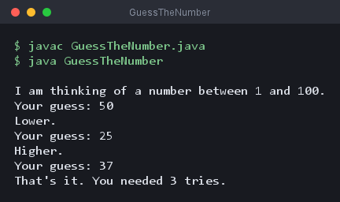
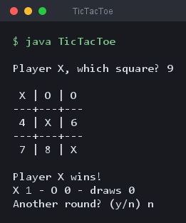
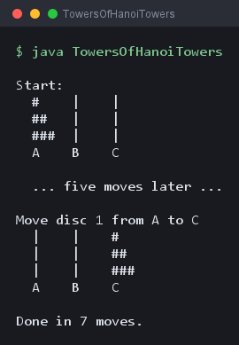
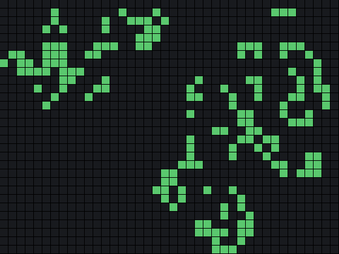

🇩🇪 Deutsch | 🇬🇧 [English](README.md)

# Java Games Course

Ein Kurs für Leute, die noch nie programmiert haben, gebaut um Spiele herum, die man
am Ende wirklich spielen kann. Jeder Kurs ist ein Spiel, und die Spiele werden in der
Reihenfolge ihrer Nummern schwerer: erst zwei Spieler auf einem Papiergitter, am Ende
ein Vogel, der an Röhren vorbeifällt.

Die Sprache ist Java, und der ganze Kurs kommt mit dem aus, was das JDK ohnehin
mitbringt. Kein Build-Werkzeug, kein Framework, keine Abhängigkeit zum Installieren.
Du schreibst eine Datei, übersetzt sie, führst sie aus. Mehr Werkzeugkette gibt es
nicht, und das bleibt über alle sieben Kurse so.

Alles gibt es zweimal, auf Deutsch und auf Englisch. Übersetzt ist die Prosa, nicht
der Code. Variablennamen, Methodennamen und Kommentare sind überall englisch, weil du
genau das in jeder echten Codebasis und in jeder Fehlermeldung lesen wirst.

## Diesen Kurs auf deinen Computer bekommen

**Weg A — ohne Git**

1. Klick oben auf dieser Seite auf den grünen Knopf **Code**.
2. Wähl **Download ZIP**.
3. Pack das Archiv dorthin aus, wo deine Projekte liegen.
4. Öffne den Ordner in deinem Editor.

**Weg B — mit Git**

```
git clone https://github.com/ftrauernicht/java-games-course.git
```

## Was du vor dem Start brauchst

| Werkzeug | Wofür du es brauchst | Link |
|---|---|---|
| Ein JDK, Version 21 oder neuer | Übersetzt und startet Java. Ohne das geht nichts. | [adoptium.net](https://adoptium.net/) |
| IntelliJ IDEA Community Edition | Ein kostenloser Editor, der Java versteht, deine Eingaben vervollständigt und Fehler zeigt, während du sie machst. | [jetbrains.com](https://www.jetbrains.com/idea/download/) |

Kurs 1 führt dich durch beide Installationen und durch das Übersetzen deines ersten
Programms auf der Kommandozeile, bevor du es dem Editor überlässt.

## Kurse

Kurs 1 bringt dir die Sprache bei. Er ist der einzige Kurs, den die anderen
voraussetzen. Alles danach ist ein Spiel, und du kannst sie in beliebiger Reihenfolge
spielen: Kurs 5 setzt Kurs 4 nicht voraus, und Kurs 7 nicht Kurs 6. Wo ein Spiel
etwas braucht, das Kurs 1 nicht behandelt hat, erklärt das Kapitel es in ein paar
Absätzen noch einmal und sagt dir, dass du weiterspringen kannst, wenn du es schon
kennst.

### Kurs 1 – Grundlagen (`courses/01-basics/`)

Die Sprache selbst, in drei Kapiteln und ohne Spiel. Er ist der einzige Kurs, den
die anderen voraussetzen, und deckt deshalb alles ab, worauf sie sich stützen:
Typen und Ablaufsteuerung, eigene Methoden, Arrays, und das Lesen dessen, was
jemand tippt.



| # | Kapitel | Was du lernst |
|---|---|---|
| 0 | [Einführung & Werkzeuge](courses/01-basics/de/00-einfuehrung.md) | JDK und Editor installieren, übersetzen und ausführen, was jedes Wort von `public static void main` bedeutet, einen Compilerfehler lesen |
| 1 | [Java-Grundlagen](courses/01-basics/de/01-java-grundlagen.md) | Typen, Rechnen und die Überraschung bei `7 / 2`, Casting und Zufallszahlen, `.equals` für Text, `if`, `switch`, `for`, `while` |
| 2 | [Methoden, Arrays und Eingaben](courses/01-basics/de/02-methoden-arrays-eingaben.md) | Eigene Methoden, Arrays und warum sie sich anders verhalten als ein `int`, `Scanner`, und ein Zahlenratespiel |

### Kurs 2 – Tic-Tac-Toe (`courses/02-tic-tac-toe/`)

Zwei Spieler an einer Tastatur, auf einem Feld, das seine eigene Bedienung
ausgibt. Das erste Spiel, deshalb bekommst du jede Zeile Code.



| # | Kapitel | Was du lernst |
|---|---|---|
| 1 | [Tic-Tac-Toe](courses/02-tic-tac-toe/de/01-tic-tac-toe.md) | Ein Gitter als `char[][]`, eine Schleife in einer Schleife, aus einer Ziffer Zeile und Spalte machen, schlechte Züge ablehnen ohne das Spiel zu beenden, acht Gewinnlinien prüfen, und die Reihenfolge, die eine Spielschleife braucht |

### Kurs 3 – Türme von Hanoi (`courses/03-towers-of-hanoi/`)

Drei Stäbe, ein Stapel Scheiben, und eine Lösung aus drei Zeilen. Das erste
Kapitel, das die Idee vollständig erklärt und dir das Schreiben überlässt.



| # | Kapitel | Was du lernst |
|---|---|---|
| 1 | [Türme von Hanoi](courses/03-towers-of-hanoi/de/01-tuerme-von-hanoi.md) | Rekursion, der Basisfall, warum Aufrufe sich stapeln und warten, einem Aufruf an eine noch unfertige Methode vertrauen, und zwei Arrays als Stapel |

### Kurs 4 – Conways Game of Life (`courses/04-game-of-life/`)

Ein Spiel ohne Spieler: vier Regeln, ein Gitter, und ein Muster, das sich von
allein entwickelt. Das erste Fenster im Repository, und es kostet sieben Zeilen und
keine eigene Klasse. Heimat des lehrreichsten Fehlers in diesem Repository.



| # | Kapitel | Was du lernst |
|---|---|---|
| 1 | [Conways Game of Life](courses/04-game-of-life/de/01-spiel-des-lebens.md) | Nachbarn mit Versatzschleifen zählen, Grenzprüfungen, warum die nächste Generation ein neues Gitter braucht, `Thread.sleep` und geprüfte Ausnahmen, und einen Index mit `%` umlaufen lassen |

### Kurs 5 – 2048 (`courses/05-2048/`)

Schieben, verschmelzen, von vorn. Vier Richtungen, die sich als eine Operation auf
einem gedrehten Feld entpuppen, und die Verschmelzungsregel, die fast jeder im
ersten Anlauf falsch macht. Das Feld steht im Fenster, getippt wird trotzdem noch --
genau der Widerspruch, den Kurs 6 auflöst.


| # | Kapitel | Was du lernst |
|---|---|---|
| 1 | [2048](courses/05-2048/de/01-2048.md) | Eine Zeile zusammenschieben und verschmelzen, ein Feld drehen, damit eine Operation vier Richtungen bedient, ein `switch` als Wert, ein Feld kopieren statt umbenennen, und warum ein Terminal keinen einzelnen Tastendruck lesen kann |

### Kurs 6 – Snake (`courses/06-snake/`)

Das erste Spiel im Fenster, und die Antwort auf die Enter-Taste: Hier kommt eine
Taste im Moment des Drucks an.


| # | Kapitel | Was du lernst |
|---|---|---|
| 1 | [Snake](courses/06-snake/de/01-snake.md) | Klassen mit Feldern und Konstruktor, `JFrame` und `JPanel`, `paintComponent` und `repaint`, ein Timer als Spielschleife, Tastaturfokus, und einen Körper vom Schwanz nach vorn bewegen |

### Kurs 7 – Flappy Bird (`courses/07-flappy-bird/`)

Schwerkraft, drei recycelte Röhren und eine Taste. Der letzte Kurs hier, und der
erste, in dem Bewegung eine Geschwindigkeit ist statt eines Schrittes.


| # | Kapitel | Was du lernst |
|---|---|---|
| 1 | [Flappy Bird](courses/07-flappy-bird/de/01-flappy-bird.md) | Geschwindigkeit und Schwerkraft als `double`, eine Klasse die nur Daten hält, ein Array von Objekten, Recyceln statt Wegwerfen, `Rectangle.intersects`, und eine Taste mit drei Bedeutungen |

## Projektideen

Der vollständige Fahrplan, inklusive der noch nicht gebauten Spiele, steht in
[PROJECT-IDEAS.de.md](PROJECT-IDEAS.de.md).

## Wie du diesen Kurs benutzt

1. **Tipp die Beispiele ab, statt sie zu kopieren.** Abtippen baut das
   Muskelgedächtnis auf, Kopieren baut nur einen Scrollbalken.
2. **Folge den drei Markern.** 🟢 ist der Weg durch das Kapitel, und den brauchst du
   ganz. 🟡 ist zusätzliche Übung zur selben Idee. 🔴 ist eine echte Herausforderung,
   und wer sie auslässt, hat später keinen Nachteil.
3. **Führ das Programm nach jedem Abschnitt aus.** Jeder endet damit, was du sehen
   solltest. Siehst du etwas anderes, ist der Fehler noch klein und in der Nähe.
4. **Nutz `code/` als Lösungsschlüssel, nicht als Abkürzung.** Dort liegt eine
   fertige Fassung des 🟢-Pfads für den Fall, dass du feststeckst, und das ist etwas
   anderes, als sie vorher zu lesen.
5. **Lies die Compilerfehler.** Java schreibt sie in ganzen Sätzen, und meistens hat
   er recht. Kurs 1 baut einen absichtlich, damit der erste echte keine Überraschung
   ist.

## Repository-Aufbau

```
courses/
  01-basics/
    en/  de/                 drei Kapitel: Werkzeuge, die Sprache, Methoden und Eingaben
    code/                    Hello.java, Basics.java, GuessTheNumber.java
  02-tic-tac-toe/
    en/  de/                 ein Kapitel
    code/                    das fertige Spiel
  03-towers-of-hanoi/
  04-game-of-life/
  05-2048/
  06-snake/                  jeder Kurs hat assets/; 4 bis 7 zeigen ein Fenster
  07-flappy-bird/
  08-.../                    kuenftige Kurse, gleiches Muster
scripts/                     die Pruefungen, die die CI ausfuehrt
```

## Mitwirken

Siehe [CONTRIBUTING.de.md](CONTRIBUTING.de.md).

## Lizenz

MIT, siehe [LICENSE](LICENSE).
