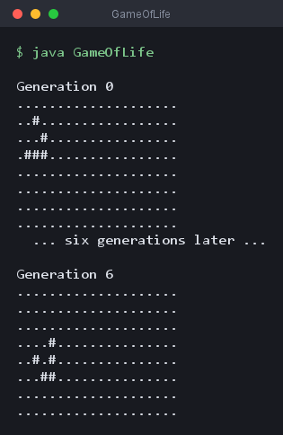

🇬🇧 English | 🇩🇪 [Deutsch](../de/01-spiel-des-lebens.md)

[← Back to course overview](../../../README.md) · Assumes: [Course 1 – Basics](../../01-basics/en/00-introduction.md)

# Course 4 – Conway's Game of Life

**Goal:** a game with no players. You place a few cells, four rules take over, and
a pattern walks across the screen on its own. On the way you will meet a mistake
whose cause is invisible in the code and obvious on the screen, and you will have
avoided it.



Assumes [Course 1](../../01-basics/en/00-introduction.md) and nothing else. A
finished version lives in [`code/GameOfLife.java`](../code/GameOfLife.java).

## 🟢 Core — Four rules

A grid of squares. Each square is either alive or dead. Every square has up to
eight neighbours, counting the diagonals.

One step produces a whole new generation, and every square decides at the same
time, using these four rules:

- A live square with fewer than two live neighbours dies.
- A live square with two or three live neighbours stays alive.
- A live square with more than three live neighbours dies.
- A dead square with exactly three live neighbours comes alive.

That is the entire game. It was invented in 1970 and people are still finding new
patterns in it.

The four rules collapse into two lines of code, which is worth noticing now so you
recognise it later: a live square survives on 2 or 3, a dead one is born on exactly
3.

## 🟢 Core — Two-dimensional arrays, in short

*(If you have done Course 2 or Course 5, skip ahead to the next section.)*

Course 1 gave you an array: a row of values under one name. A grid is an array
whose values are themselves arrays:

```java
boolean[][] grid = new boolean[ROWS][COLS];
```

Two pairs of brackets, two sizes. `grid[3][7]` is row 3, column 7, and both count
from 0. `boolean` is the type because a square is alive or dead and nothing else,
and a fresh `boolean` array is already full of `false`, so there is nothing to fill
in.

Walking the whole grid is a loop inside a loop:

```java
for (int row = 0; row < ROWS; row++) {
    for (int col = 0; col < COLS; col++) {
        // grid[row][col]
    }
}
```

Handing the grid to a method hands over the grid itself and not a copy, so a method
can change it. Course 1 covered that under "arrays are references". This chapter
mostly avoids using it: every method below reads a grid and returns a new one
rather than changing what it was given. The one place it matters is the mistake
the chapter warns about, further down.

Set up your file. The three sizes go in the class, next to `main` rather than
inside it, because `print` and `countNeighbours` need them too. They are `static`
for the same reason every method here is `static`: they belong to the class, and
nothing has been created yet. Write `final int ROWS = 10;` inside `main` instead
and you get `non-static variable ROWS cannot be referenced from a static context`,
eleven times over.

```java
public class GameOfLife {

    static final int ROWS = 10;
    static final int COLS = 20;
    static final int GENERATIONS = 8;

    public static void main(String[] args) {
        boolean[][] grid = new boolean[ROWS][COLS];
    }
}
```

## 🟢 Core — Drawing the grid

A live square is a `#`, a dead one is a `.`:

```java
static void print(boolean[][] grid, int generation) {
    System.out.println("Generation " + generation);
    for (int row = 0; row < ROWS; row++) {
        for (int col = 0; col < COLS; col++) {
            System.out.print(grid[row][col] ? '#' : '.');
        }
        System.out.println();
    }
    System.out.println();
}
```

The `? :` from Course 1 picks the character. The inner loop prints one row with no
line breaks, and the `println` after it ends the line, which is why the grid comes
out as a grid rather than one long string.

Generations print one under another, with a heading, rather than redrawing in
place. Clearing a terminal needs escape codes that Windows Terminal understands and
a plain console window prints as garbage, so the portable choice is to scroll. It
also lets you look back at generation 3, which you will want to do.

Now something to look at. A **glider** is five cells that walk diagonally forever:

```java
grid[1][2] = true;
grid[2][3] = true;
grid[3][1] = true;
grid[3][2] = true;
grid[3][3] = true;
```

```java
print(grid, 0);
```

```
Generation 0
....................
..#.................
...#................
.###................
....................
```

That is the first five of ten rows. The rest are empty and are left out here to
keep the page short, so do not count lines against your own output.

## 🟢 Core exercise — Counting neighbours

Every rule needs the same number: how many of the eight squares around this one
are alive.

```java
static int countNeighbours(boolean[][] grid, int row, int col) {
    // your code here -- the four steps below
}
```

1. Start a counter at 0.
2. Loop over the nine squares around and including this one, with two loops
   running from -1 to 1. Call the offsets `dRow` and `dCol`; the square being
   looked at is `row + dRow`, `col + dCol`.
3. Skip two kinds of square: the one in the middle, where both offsets are 0,
   because a square is not its own neighbour; and any square outside the grid,
   where the row is below 0 or at least `ROWS`, or the column is below 0 or at
   least `COLS`. `continue` is the tool for both.
4. For the rest, add 1 to the counter if that square is alive, then return the
   counter.

Step 3 is the whole exercise. A cell in the middle has eight neighbours, a cell on
an edge has five, and a corner has three. Get the bounds wrong and the program
stops with `ArrayIndexOutOfBoundsException` the first time it looks at row 0,
which at least tells you immediately.

Test it before going on. On the glider above, `countNeighbours(grid, 2, 2)` should
be 5, and `countNeighbours(grid, 0, 0)` should be 0.

## 🟢 Core exercise — The next generation

```java
static boolean[][] nextGeneration(boolean[][] grid) {
    // your code here -- the three steps below
}
```

1. Make a **new** grid of the same size.
2. For every square, count its neighbours in the **old** grid and write the result
   into the **new** one: a live square survives with 2 or 3 neighbours, a dead one
   is born with exactly 3.
3. Return the new grid.

Step 1 is not an optimisation and it is not a style preference. Writing results
into the grid you are still reading from means that by the time you reach row 5,
rows 0 to 4 already hold next-generation values, so row 5 counts the wrong
neighbours. Every square after the first is then deciding against a mixture of two
different moments in time.

Build it the wrong way once and watch what happens. The glider does not drift or
smear; it falls apart. Five cells, then three, then four, and from generation 2 on
a frozen two-by-two block that never changes again. The r-pentomino further down,
which should stay busy for over a thousand generations, is finished after four.

So the symptom is loud, which is lucky. What is quiet is the cause: nothing about
the code looks wrong, every rule is implemented correctly, and the mistake is
entirely in when the writing happens relative to the reading. That is why this is
worth meeting on purpose rather than reading about.

Now the loop in `main`:

```java
for (int generation = 0; generation <= GENERATIONS; generation++) {
    print(grid, generation);
    grid = nextGeneration(grid);
}
```

`grid = nextGeneration(grid)` points the variable at the new grid, and the old one
is simply forgotten. Run it and count the `#` in each generation: five, every time.
Compare generation 0 and generation 4, and you should see the same shape, moved one
down and one right.

## 🟢 Core — A pause between generations

Eight generations arrive faster than you can read them. Java can wait:

```java
Thread.sleep(300);
```

Three hundred milliseconds. Put it between the `print` and the `nextGeneration`,
and the compiler refuses to build your program:

```
GameOfLife.java:17: error: unreported exception InterruptedException; must be caught or declared to be thrown
            Thread.sleep(300);
                       ^
1 error
```

The line number depends on where you put it. Note also that `Thread` needed no
`import`: a handful of classes, the ones in `java.lang`, are always available, and
`Thread`, `String`, `Math` and `System` are among them. Everything else needs the
import line you met with `Scanner`.

This is a new kind of complaint, and it is worth understanding rather than working
around. Some methods warn in their signature that something can go wrong while they
run. `Thread.sleep` says that the waiting can be cut short from outside. Java does
not let you ignore such a warning: you either deal with it, or you pass it on to
whoever called you.

Passing it on is one phrase on `main`:

```java
public static void main(String[] args) throws InterruptedException {
```

Read it as "if that ever happens, let the program stop and say so". For a pause
between two frames that is the right answer, and nobody is going to interrupt this
program anyway.

You will meet the other way of dealing with it, `try` and `catch`, in a later
course where it earns its place. Here it would be four lines of ceremony around a
thing that cannot happen.

## 🟡 Optional — A world without edges

The glider walks until it reaches a wall and then falls apart, because squares
outside the grid count as dead.

Make the grid wrap: the square to the right of the last column is the first column,
and the square above row 0 is the bottom row. The grid becomes the surface of a
doughnut, and the glider walks forever.

The change is in `countNeighbours`. Instead of skipping out-of-range squares, bring
them back in range:

```java
int r = (row + dRow + ROWS) % ROWS;
int c = (col + dCol + COLS) % COLS;
```

Work out why the `+ ROWS` is there. The remainder operator in Java keeps the sign
of the left-hand side, so `-1 % 10` is `-1` and not `9`. Adding `ROWS` first makes
the number positive before the remainder is taken, and it cannot push anything past
the top because `dRow` is never more than 1.

Run the glider for forty generations -- raise `GENERATIONS` -- and watch it come
back around.

One thing to be careful of afterwards: the check value from the core exercise,
`countNeighbours(grid, 0, 0)` being 0, is still 0 with wrapping, but no longer for
the reason it was. Corner cells now have eight neighbours like everybody else, and
the answer is 0 only because the glider happens to live nowhere near them. Reusing
an old check after changing what it tests is how a green result stops meaning
anything.

## 🟡 Optional — Other patterns

Replace the glider and see what else the four rules do.

A **blinker** is three cells in a row. It flips between horizontal and vertical
forever, which makes it the smallest thing that repeats.

A **block** is a two by two square. Every cell in it has exactly three neighbours,
so it sits there unchanged.

An **r-pentomino** is five cells in a small zigzag. Relative to some row `r` and
column `c` in the middle of the grid, it is `(r, c)`, `(r, c+1)`, `(r+1, c-1)`,
`(r+1, c)` and `(r+2, c)`.

It is famous for staying busy for a very long time from almost nothing, but how
long depends sharply on how much room it has, because the walls kill what reaches
them. Measured here, counting generations until it settles or starts repeating:
135 on a 20 by 40 grid, 435 on 30 by 60, 653 on 60 by 120, and 1104 on 80 by 160,
after which more room changes nothing. So "over a thousand" needs roughly 80 by
160, and a grid that size does not fit in a terminal window -- count live cells
per generation instead of drawing it.

## 🟡 Optional — Animating in place

If your terminal supports it, you can redraw over the previous frame instead of
scrolling. Print this before each generation:

```java
System.out.print("\u001B[H\u001B[2J");
System.out.flush();
```

Two escape sequences: move the cursor to the top left, then clear the screen. They
work in Windows Terminal, in the terminal inside most editors, and on macOS and
Linux. They do **not** work in an old Windows console window, where you get `[2J`
printed as text, which is why the green path does not use them.

Try it, and keep whichever version reads better on your machine.

## 🔴 Optional, genuine challenge — Notice when nothing changes

Many starting patterns settle down. A grid that has stopped changing will keep
printing the same picture until the loop runs out, which is a waste of everyone's
time.

Stop early when a generation is identical to the one before it.

```java
static boolean same(boolean[][] a, boolean[][] b) {
    // your code here -- answer whether every square matches
}
```

`same` is the easy half. The work is the loop in `main`, which currently has
nowhere to put the comparison: `grid = nextGeneration(grid)` overwrites the old
grid in the same breath as making the new one, so there is nothing left to compare
against. Take it apart -- hold the new grid in a local variable, compare, `break`
if nothing changed, and only then assign.

Comparing with `==` will not do what you want: Course 1 explained that for text,
and the same reason applies here. `a == b` asks whether they are the same grid, not
whether they hold the same thing. You have to walk both and compare square by
square.

Then the honest part. That catches a grid frozen solid, and it does not catch a
blinker, which alternates between two pictures and never settles. Try it on a
blinker and watch it run to the end.

To catch that too, keep the generation before last as well and compare against
both.

That brings its own trap. In generation 0 there is no generation before last, so
the variable holding it is still `null`, and handing `null` to `same` gives you
`NullPointerException: Cannot load from object array`. Course 1 met `null` for
text, where the fix was to put the known value first; that trick does not exist
for arrays. Here you check before you ask: `if (twoAgo != null && same(next, twoAgo))`.
The `&&` stops as soon as the left half is false, so `same` is never reached with
nothing in hand.

Then ask yourself what a pattern with a period of three would do to your program,
and decide whether you care. Knowing exactly which cases your check misses is worth
more than a check that claims to catch everything.

## What you learned

- A grid as `boolean[][]`, and walking it with a loop inside a loop
- Counting neighbours with two offset loops from -1 to 1
- Skipping the centre square and anything outside the grid, with `continue`
- **Why the next generation has to be built in a new grid**
- That a wrong simulation can look entirely plausible, and that a known pattern is
  how you catch it
- `Thread.sleep`, and what a checked exception is
- `throws` on `main` as the honest small answer to one
- *(optional)* `(x + SIZE) % SIZE` to wrap an index, and why the `+ SIZE` is needed
- *(optional)* Why terminal escape codes are not portable
- *(optional)* Comparing two grids square by square, and knowing what the check
  misses
- *(optional)* `null` in an array variable, and guarding with `&&` before asking

## Next

Course 5 is 2048, where a grid does not evolve on its own but slides and merges
under four keys, and where the merge rule catches everybody out. It assumes Course
1 and nothing else.

The full list is in [PROJECT-IDEAS.md](../../../PROJECT-IDEAS.md).
