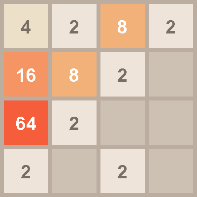

🇬🇧 English | 🇩🇪 [Deutsch](../de/01-2048.md)

[← Back to course overview](../../../README.md) · Assumes: [Course 1 – Basics](../../01-basics/en/00-introduction.md)

# Course 5 – 2048

**Goal:** the sliding tile game, playable in a terminal. Four directions that are
really one operation applied to a turned board, and a merging rule that almost
everybody gets wrong on the first attempt.



This is also where the console runs out of road, and the chapter says so plainly
rather than pretending otherwise.

Assumes [Course 1](../../01-basics/en/00-introduction.md) and nothing else. A
finished version lives in [`code/Game2048.java`](../code/Game2048.java).

## 🟢 Core — The game, and the name of the class

A four by four board. Every move slides every tile as far as it goes in one
direction. Two tiles with the same number that run into each other merge into one
tile of twice the value. After every move that changed something, a new tile
appears on a free square.

Start the file. It cannot be called `2048.java`, because a Java name may not begin
with a digit, so the class is `Game2048` and the file is `Game2048.java`:

```java
import java.util.Scanner;

public class Game2048 {

    static final int SIZE = 4;

    public static void main(String[] args) {
    }
}
```

## 🟢 Core — Two-dimensional arrays, in short

*(If you have done Course 2 or Course 4, skip ahead to the next section.)*

Course 1 gave you an array: a row of values under one name. A board is an array
whose values are themselves arrays:

```java
int[][] board = new int[SIZE][SIZE];
```

`board[1][2]` is row 1, column 2, and both count from 0. The type is `int` because
a square holds a number, and a fresh `int` array is full of zeros, so 0 can stand
for an empty square without any setting up.

Walking the whole board is a loop inside a loop:

```java
for (int row = 0; row < SIZE; row++) {
    for (int col = 0; col < SIZE; col++) {
        // board[row][col]
    }
}
```

One more thing this chapter uses: `board[row]` on its own, without a second pair
of brackets, is the whole row, and it is an `int[]`. A board is really an array of
rows, so a method that works on one row can be handed `board[2]` directly.

It works the other way round too, and both key moments in this chapter depend on
it: `board[row] = someOtherRow` replaces that whole row in one go. Course 1 said an
array variable holds the location of its values rather than the values themselves,
and this is that fact doing something useful.

## 🟢 Core — Printing a board whose numbers grow

Tiles start at 2 and can reach four digits, so a fixed width keeps the columns
lined up. Course 1's `printf` does it:

```java
static void print(int[][] board) {
    System.out.println();
    for (int row = 0; row < SIZE; row++) {
        for (int col = 0; col < SIZE; col++) {
            if (board[row][col] == 0) {
                System.out.printf("%5s", ".");
            } else {
                System.out.printf("%5d", board[row][col]);
            }
        }
        System.out.println();
    }
    System.out.println();
}
```

```
    .    .    2    .
    .    4    .    .
    .    .    .    .
    .    .    .    .
```

`%5d` is a number in a field five characters wide, `%5s` the same for text. Without
the width, a row holding 2 and 1024 would be ragged and unreadable.

A new tile goes on a random free square, and is usually a 2:

```java
static void spawn(int[][] board) {
    while (true) {
        int row = (int) (Math.random() * SIZE);
        int col = (int) (Math.random() * SIZE);
        if (board[row][col] == 0) {
            board[row][col] = Math.random() < 0.9 ? 2 : 4;
            return;
        }
    }
}
```

Guessing until the guess lands on a free square is fine while the board is mostly
empty, and this one is never called on a full board.

Put two tiles down and print:

```java
int[][] board = new int[SIZE][SIZE];
spawn(board);
spawn(board);
print(board);
```

## 🟢 Core — Typing a move, and the Enter key in the way

In the real game you press an arrow key and the board moves at once. Here you will
type a letter and press Enter, and that is not a shortcut. Java cannot read a
single keypress from a terminal at all. The terminal collects a whole line before
handing anything over, and the JDK has no way to ask it to stop doing that. Arrow
keys are worse: they arrive as several characters at once.

So: `w`, `a`, `s`, `d`, and `q` to quit, each followed by Enter.

```java
Scanner in = new Scanner(System.in);

System.out.print("Move (w/a/s/d, q to quit): ");
String line = in.nextLine().trim().toLowerCase();
```

`.toLowerCase()` means a stray capital `W` still works, and `.trim()` forgives a
space.

Handle the quit key before anything else, because it is not a direction and has no
business going through the direction lookup:

```java
if ("q".equals(line)) {
    System.out.println("Bye.");
    return;
}
``` This is the limit that Courses 6 and 7 escape by opening a window, where a
key arrives the moment it is pressed. It is worth knowing which of the two is the
real constraint: the terminal, not Java's ability to make games.

## 🟢 Core exercise — Sliding one row

Everything in this game happens to a single row, moved to the left. Get that right
and the rest is bookkeeping.

```java
static int[] slideRowLeft(int[] row) {
    // your code here -- the three steps below
}
```

1. **Compact.** Walk the row and copy every non-zero value into a new array, one
   after another from position 0. Gaps disappear; order stays.
2. **Merge.** Walk the compacted array from left to right, stopping one short of
   the end, because each step looks at the value next to it as well. Whenever a
   value is not 0 and equals the one beside it, double the first and set the
   second to 0.
3. **Compact again.** Merging leaves holes, so do step 1 once more and return the
   result.

Step 2 stops at `SIZE - 1` and not at `SIZE`. The loop reads `packed[i + 1]`, so
running all the way to the end reaches one past the array and stops the program
with `ArrayIndexOutOfBoundsException: Index 4 out of bounds for length 4`.

A tile may merge at most once per move, and in this version the test for 0 is what
enforces that: a merged partner becomes 0, so the next step cannot pick it up
again. That is worth knowing because it is easy to assume some extra bookkeeping
is needed and then write it.

Work these out on paper before you write anything:

```
2 2 2 2   becomes   4 4 . .      (two separate merges, not one 8)
4 2 2 .   becomes   4 4 . .      (the two 2s merge; the 4 is untouched)
2 2 4 .   becomes   4 4 . .      (same result, different reason)
4 4 4 4   becomes   8 8 . .
2 4 2 4   becomes   2 4 2 4      (nothing merges, nothing moves)
```

The third line is the one that decides whether your version is right, and the
reason is worth meeting head-on.

Three steps with a separate array look like more work than they need to be, and
the tempting shortcut is to build the result in one pass: keep a write position,
and for each incoming value either start a new tile or double the one you just
wrote. It is shorter and it is wrong. On `2 2 4 .` it merges the two 2s into a 4,
then meets the existing 4 next to the 4 it has just written, and merges again:
`8 . . .`. The tile it created in this move merges a second time in the same move.

Compact, merge, compact avoids that because the merging pass only ever looks at
values that were already there when the pass started. The cost is one extra array
and one extra walk; the benefit is a rule that cannot be broken by accident.

Test your method on all five rows above before going near the board.

## 🟢 Core — Four directions, one operation

You now have "left". Rather than writing three more versions, turn the board and
use the one you have.

```java
static void rotateClockwise(int[][] board) {
    int[][] turned = new int[SIZE][SIZE];
    for (int row = 0; row < SIZE; row++) {
        for (int col = 0; col < SIZE; col++) {
            turned[col][SIZE - 1 - row] = board[row][col];
        }
    }
    for (int row = 0; row < SIZE; row++) {
        board[row] = turned[row];
    }
}
```

The square at `(row, col)` lands at `(col, SIZE - 1 - row)`. Take a piece of paper
with a letter in each corner and turn it a quarter turn to convince yourself.

The last loop copies the rows back into the board that was handed in, so the caller
sees the change. Assigning `board = turned` would only point the local name at the
new one and change nothing outside, which is the limit of what "arrays are
references" buys you.

Then a move is: turn, slide every row left, turn back.

```java
static void move(int[][] board, int rotations) {
    for (int i = 0; i < rotations; i++) {
        rotateClockwise(board);
    }

    for (int row = 0; row < SIZE; row++) {
        board[row] = slideRowLeft(board[row]);
    }

    for (int i = 0; i < (4 - rotations) % 4; i++) {
        rotateClockwise(board);
    }
}
```

How many turns for which direction is worth deriving rather than memorising, but
here is the answer so you can check yourself: left is 0, down is 1, right is 2, up
is 3. Test each one with a single tile in a known corner and see where it ends up.

The `switch` from Course 1 turns a letter into that number:

```java
int rotations = switch (line) {
    case "a" -> 0;
    case "s" -> 1;
    case "d" -> 2;
    case "w" -> 3;
    default -> -1;
};

if (rotations < 0) {
    System.out.println("Type w, a, s or d, or q to quit.");
    continue;
}
```

This is a `switch` used as a value rather than as a statement: the whole thing
produces a number, which is why it ends with a semicolon. `-1` stands for "not a
direction", in the same way Course 2 used 0 for "no square".

## 🟢 Core — A move that changes nothing

Push everything left twice and the second push does nothing. If a new tile appears
anyway, the player gets free tiles for pressing a key that did not move anything,
and the board fills up with no game played.

So compare before and after:

```java
int[][] before = copy(board);
move(board, rotations);

if (same(before, board)) {
    System.out.println("Nothing moves that way.");
    continue;
}

spawn(board);
```

`copy` and `same` are both a loop inside a loop, one writing and one comparing:

```java
static int[][] copy(int[][] board) {
    int[][] result = new int[SIZE][SIZE];
    for (int row = 0; row < SIZE; row++) {
        for (int col = 0; col < SIZE; col++) {
            result[row][col] = board[row][col];
        }
    }
    return result;
}
```

Why not `int[][] before = board;`? Because that is one board with two names, and
after the move both names show the moved board. The comparison then always says
"nothing changed", so no tile ever appears and the game announces
"Nothing moves that way." after every single move, while the board visibly moves.
Course 1 warned about exactly this under "arrays are references", and this is the
place where forgetting it produces a game that looks broken in a way the code does
not explain.

Write `same` yourself; it is `copy` with a comparison instead of an assignment, and
an early `return false`.

Now the loop in `main`: print, read, convert, move, compare, spawn. Add a check for
a full board to end the game, and you have something playable.

## 🟡 Optional — A score

Add up the value of every merge and show the total. The only place a merge happens
is inside `slideRowLeft`, which returns a row and so has nowhere to put a second
answer.

The straightforward way needs something Course 1 did not show: a variable that
lives in the class rather than in a method, so that `slideRowLeft` and `main` can
both reach it.

```java
static int score;
```

Unlike `SIZE` it is not `final`, because it changes. Add to it where the merge
happens, print it next to the board, and reset it where a new game starts.

One interaction to watch for if you also do the red challenge below: a game-over
check that tries all four moves to see whether any of them does something would
run `slideRowLeft` for each trial and inflate the score. The neighbour test in that
section avoids the problem by not moving anything, which is one more reason to
prefer it.

## 🟡 Optional — Several moves on one line

One move per Enter gets tedious. Accept `wasd` as four moves in one line, by
looping over the characters with `charAt` from Course 1 and treating each as its
own move.

Mind the detail this exposes: after each letter you have to check whether the board
changed and whether to spawn, exactly as the single-move version does.

## 🔴 Optional, genuine challenge — Game over, properly

The green version ends when the board is full. That is not the real rule. A full
board is still playable if two equal tiles sit next to each other, because that
move merges them and frees a square.

Write the real check: the game is over when there is no empty square **and** no two
orthogonal neighbours are equal.

```java
static boolean isGameOver(int[][] board) {
    // your code here -- no empty square, and no equal neighbours
}
```

Comparing each square with the one to its right and the one below it is enough to
cover every neighbouring pair exactly once. Work out why checking left and up as
well would be wasted effort.

Then the second half, which is harder to resist getting wrong: a tile merging
freely in one direction may be blocked in another. Convince yourself that the
neighbour test above does not care about direction, and that this is correct.

Build a full board on purpose to test it, by filling the array by hand in `main`
before the loop starts.

## What you learned

- A board as `int[][]`, and `board[row]` as a whole row you can hand to a method
- `%5d` to keep columns aligned up to four digits, which is as far as this game goes
- That a terminal cannot deliver a single keypress, and what that costs
- Compact, merge, compact, and why a tile may merge only once
- Turning a board so that one operation serves all four directions
- A `switch` used as a value rather than as a statement
- Copying a board rather than renaming it, and why the difference decides the game
- *(optional)* Checking every neighbouring pair exactly once

## Next

Course 6 is Snake, the first course with a window. It is also the answer to the
Enter key: a window hands you a key the moment it is pressed. It assumes Course 1
and nothing else.

The full list is in [PROJECT-IDEAS.md](../../../PROJECT-IDEAS.md).
