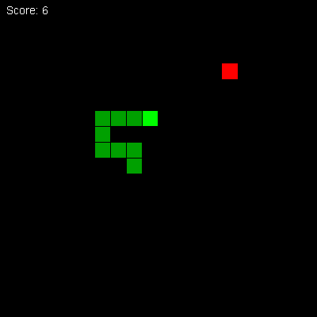
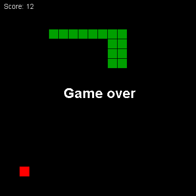

🇩🇪 Deutsch | 🇬🇧 [English](../en/01-snake.md)

[← Zurück zur Kursübersicht](../../../README.de.md) · Setzt voraus: [Kurs 1 – Grundlagen](../../01-basics/de/00-einfuehrung.md)

# Kurs 6 – Snake

**Ziel:** das erste Spiel in einem Fenster. Eine Taste, die im Moment des Drucks
ankommt, ein Timer, der das Spiel antreibt statt einer Schleife, und eine Schlange,
die wächst, bis du sie irgendwo hineinfährst.



Setzt [Kurs 1](../../01-basics/de/00-einfuehrung.md) voraus und sonst nichts. Eine
fertige Fassung liegt in [`code/`](../code/), in zwei Dateien.

## 🟢 Kern — Warum überhaupt ein Fenster

Ein Terminal gibt deinem Programm eine Zeile auf einmal. Es wartet auf Enter, und
daran ändert nichts, was du in Java schreiben kannst, denn das Warten passiert,
bevor dein Programm beteiligt ist. Für ein Spiel, in dem man etwas fortlaufend
steuert, ist das das Ende des Weges.

Ein Fenster hat diesen Mittelsmann nicht. Drück eine Taste, und dein Programm
erfährt es sofort, samt Taste, während das Spiel weiterläuft.

Das ist der einzige Grund, warum dieser Kurs ein Fenster öffnet. Alles andere an
Swing in diesem Kapitel ist das Mindeste, um ein Rechteck auf den Bildschirm und
eine Taste in deinen Code zu bekommen.

## 🟢 Kern — Klassen und Objekte, kurz erklärt

*(Wenn du Kurs 7 gemacht hast, überspring das und lies beim nächsten Abschnitt
weiter.)*

Kurs 1 nannte eine Klasse „eine Schachtel mit Namen" und versprach die richtige
Antwort später. Jetzt ist später.

Eine Klasse beschreibt, was etwas **ist** und was es **kann**, an einer Stelle. Die
Beschreibung nennt die Werte, die es enthält, genannt **Felder**, und die Methoden,
die damit arbeiten. Aus der Beschreibung baust du mit `new` ein echtes Ding, ein
**Objekt**:

```java
public final class Counter {
    private int count;          // ein Feld: jeder Counter hat sein eigenes

    void add() {                // kein static: das arbeitet an einem Counter
        count++;
    }

    int get() {
        return count;
    }
}
```

```java
Counter a = new Counter();
Counter b = new Counter();
a.add();
a.add();
b.add();
System.out.println(a.get() + " " + b.get());
```

```
2 1
```

Zwei Objekte, zwei getrennte `count`-Felder. Das ist der ganze Unterschied zu den
`static`-Methoden aus Kurs 1: Die gehören zur Klasse und es gibt sie je einmal,
während diese zu einem Objekt gehören und es sie einmal pro Objekt gibt.

Fünf Wörter kommen in diesem Kapitel vor, die Kurs 1 nicht gezeigt hat.

`extends` heißt „fang bei dieser Klasse an und ändere eine Sache". Was dahinter
steht, kann von der ersten Zeile an alles, was die genannte Klasse kann, und du
schreibst nur auf, was anders sein soll.

`@Override` ist eine Zusage an den Compiler: „diese Methode gibt es oben schon, ich
ersetze sie". Sie ist freiwillig und trotzdem richtig. Vertippst du dich im Namen,
ist das ohne `@Override` eine neue Methode, die nie jemand ruft, und du siehst ein
leeres Fenster ohne Fehlermeldung. Mit `@Override` sagt dir der Compiler, dass oben
nichts mit diesem Namen steht.

`private` an einem Feld heißt, dass nur diese Klasse es anfassen darf, und das hält
den Spielzustand davon ab, versehentlich von außen geändert zu werden.

`protected` ist die Stufe dazwischen: für die Klasse selbst und für jeden, der von
ihr erbt. Du wirst es gleich an `paintComponent` sehen, und es steht dort nicht,
weil du es dir ausgesucht hast, sondern weil `JPanel` es so vorgibt. Überschreiben
darf eine Methode zugänglicher machen, aber nie verschlossener.

`final` an einer Klasse heißt, dass niemand eine Abwandlung darauf aufbauen darf;
warum das hier so ist, steht im nächsten Abschnitt.

Und ein Wort, das man leicht übersieht, weil es gar nicht dasteht: Eine Methode
**ohne** Sichtbarkeitswort gehört dem Paket. Im Spiel unten ist `spawnFood`
`private`, weil nur das Panel sie braucht, während `tick` und `steer` keines haben,
weil die andere Datei sie ruft. Mach `tick` versuchsweise `private`, und die andere
Datei übersetzt nicht mehr.

## 🟢 Kern — Ein Fenster, eine Fläche, und eine Methode

Drei Tatsachen, und du hast alles, was dieses Kapitel von Swing braucht.

**Ein Fenster ist ein `JFrame`, und darauf zeichnest du nicht.** Du setzt etwas
hinein, auf das sich zeichnen lässt.

**Dieses Etwas ist ein `JPanel`, und gezeichnet wird, indem du eine Methode
ersetzt.** Du baust dein eigenes Panel, das `extends JPanel`, und überschreibst
`paintComponent`:

```java
import java.awt.Color;
import java.awt.Graphics;
import javax.swing.JPanel;

public final class SnakePanel extends JPanel {
    @Override
    protected void paintComponent(Graphics g) {
        super.paintComponent(g);
        g.setColor(Color.RED);
        g.fillRect(40, 40, 20, 20);
    }
}
```

Das ist eine vollständige Datei: Speicher sie als `SnakePanel.java`, und
`javac SnakePanel.java` übersetzt sie. Starten lässt sie sich noch nicht, es gibt
kein `main`.

Merk dir, wo die Namen herkommen, denn das ist das Erste, woran man hängenbleibt:
`JPanel`, `JFrame` und `Timer` liegen in `javax.swing`, alles zum Zeichnen in
`java.awt`, und alles rund um Tasten in `java.awt.event`. Die vollständige Liste
für dieses Spiel steht im nächsten Abschnitt.

`extends JPanel` heißt: Sei in jeder Hinsicht ein Panel, außer bei der einen
Methode, die darunter steht. `super.paintComponent(g)` gibt für einen Moment an das
Original zurück, damit es den Hintergrund löschen kann, und wer es weglässt, behält
die Pixel des letzten Bildes.

`Graphics g` ist das, womit du zeichnest. `fillRect(x, y, breite, hoehe)` ist ein
gefülltes Rechteck, `setColor` wählt die Farbe, `drawString` schreibt Text. Die
Koordinaten sind Pixel von links oben, und y wächst **nach unten**.

**`paintComponent` rufst du nie selbst auf.** Du rufst `repaint()`, womit du Swing
bittest, bei Gelegenheit neu zu zeichnen, und Swing ruft dann `paintComponent` für
dich. Das ist die Idee, die am längsten braucht, bis sie sitzt, und die Regel
daraus ist kurz: Erst den Spielzustand ändern, dann `repaint` rufen, nie andersherum.

Die Klasse ist `final`, und zwar aus Vorsicht und nicht aus Zwang. Ihr Konstruktor
ruft gleich `setBackground` auf, eine von `JPanel` geerbte Methode. Eine
Unterklasse könnte die überschreiben, und ihre Fassung liefe dann, bevor ihre
eigenen Felder überhaupt existieren. Der Compiler kennt diese Gefahr, warnt aber
erst, wenn sie wirklich besteht, und dazu gehören zwei Dinge: eine Klasse ohne
`final` **und** ein Konstruktor, den jemand von außerhalb des Pakets erreichen
kann. Probier beides aus:

```
nimm das final weg                            -> still, keine Warnung
nimm es weg und schreib public vor SnakePanel() ->
warning: [this-escape] possible 'this' escape before subclass is fully initialized
```

Der Konstruktor hier hat kein Sichtbarkeitswort, deshalb bliebe es auch ohne
`final` still. Das Wort steht trotzdem da, weil es die Gefahr für immer
ausschließt, auch für den Tag, an dem jemand `public` davorschreibt.

## 🟢 Kern — Das Gerüst, einmal vollständig

Alles, was in diesem Kapitel noch kommt — `tick`, `spawnFood`, `steer`,
`paintComponent` — gehört in **eine** Datei, `SnakePanel.java`, innerhalb derselben
geschweiften Klammern. Hier ist sie mit allen Importen und allen Feldern, und mit
Löchern an den Stellen, die du selbst füllst:

```java
import java.awt.Color;
import java.awt.Font;
import java.awt.Graphics;
import java.awt.event.KeyEvent;
import javax.swing.JPanel;

public final class SnakePanel extends JPanel {

    static final int COLS = 20;
    static final int ROWS = 20;
    static final int CELL = 20;

    private final int[] x = new int[COLS * ROWS];
    private final int[] y = new int[COLS * ROWS];
    private int length = 3;

    private int dirX = 1;
    private int dirY = 0;

    private int foodX;
    private int foodY;
    private int score;
    private boolean gameOver;

    SnakePanel() {
        // kommt zwei Abschnitte weiter unten
    }

    void tick() {
        // die Kernübung
    }

    private void spawnFood() {
        // steht fertig in der Kernübung
    }

    void steer(int keyCode) {
        // steht fertig im Abschnitt über Tasten
    }

    @Override
    protected void paintComponent(Graphics g) {
        // steht fertig im Abschnitt über das Zeichnen
    }
}
```

Zwei Dinge an den drei Konstanten oben sind neu.

Sie stehen **innerhalb der Klasse und außerhalb jeder Methode**, und nur deshalb
kommt jede Methode an sie heran. Das `final int` aus Kurs 1 stand in einer Methode
und galt nur dort. Schreibst du `COLS` in den Konstruktor, findet `paintComponent`
es nicht.

Und sie haben **kein `private`**. Die andere Datei, `Snake.java`, braucht `COLS`
und `CELL`, um die Fenstergröße auszurechnen. Mit `private` bekämst du dort
`COLS has private access in SnakePanel`.

## 🟢 Kern — Die Schlange als zwei Arrays

Eine Liste wäre die erwachsene Antwort, und Kurs 1 hat keine Listen behandelt. Er
muss auch nicht: Die Schlange kann nie länger werden als das Feld, ein Paar Arrays
dieser Größe reicht also.

Stelle 0 ist der Kopf. `x[0]`, `y[0]` ist, wo er steht, in **Feldern**, nicht in
Pixeln. Das Spielfeld ist 20 mal 20 Felder zu je 20 Pixeln, und das hält jede
Rechnung in ganzen Zahlen und macht „hat der Kopf das Futter erreicht" zu einem
schlichten Vergleich.

Die Richtung ist ein Schritt pro Takt. Rechts ist `(1, 0)`, links `(-1, 0)`, hoch
`(0, -1)`, runter `(0, 1)`. Hoch ist negativ, weil y nach unten wächst.

Die Startschlange baust du im Konstruktor auf, einer Methode mit dem Namen der
Klasse, die beim Erzeugen des Objekts läuft:

```java
SnakePanel() {
    setBackground(Color.BLACK);
    for (int i = 0; i < length; i++) {
        x[i] = 3 - i;
        y[i] = 3;
    }
    spawnFood();
}
```

Drei Glieder in einer Reihe bei `(3,3)`, `(2,3)`, `(1,3)`, Kopf zuerst.

## 🟢 Kernübung — Ein Schritt des Spiels

```java
void tick() {
    // dein Code hier -- die fünf Schritte unten
}
```

1. Wenn das Spiel schon vorbei ist, kehr zurück und tu nichts.
2. **Beweg den Körper.** Lauf vom Schwanz nach vorn, `i` von `length - 1` herunter
   bis 1, und kopier Glied `i - 1` in Glied `i`. Beweg danach den Kopf, indem du
   `dirX` und `dirY` auf `x[0]` und `y[0]` addierst.
3. **Wand.** Ist die Spalte des Kopfes unter 0 oder mindestens `COLS`, oder seine
   Zeile unter 0 oder mindestens `ROWS`, ist das Spiel vorbei.
4. **Sich selbst.** Vergleich den Kopf mit jedem anderen Glied. Lauf dafür von 1
   **bis einschließlich** `length - 1`, also `for (int i = 1; i < length; i++)`.
   Eine Übereinstimmung beendet das Spiel.
5. **Futter.** Steht der Kopf auf dem Futter: Gib dem neuen Glied zuerst die
   Position, auf der der Schwanz gerade steht, zähl dann eins auf `length` und auf
   den Punktestand, und leg neues Futter aus.

In Schritt 2 steckt der Fehler. Läuft man **vorwärts** durch den Körper, von 1 bis
`length - 1`, kopiert man den Kopf ins erste Glied und denselben Wert dann ins
zweite. Der ganze Körper sitzt danach auf einem Feld, der Kopf einen Schritt davor,
und sichtbar sind also zwei Felder statt einer Schlange:

```
......oH............
```

Woran du es im Spiel merkst, ist nicht „sie fällt zusammen", sondern **„sie wird
nie länger"**: Du frisst, der Punktestand steigt, und das Bild bleibt gleich.
Rückwärts nimmt jedes Glied den Platz des Gliedes vor ihm ein, bevor dieses sich
bewegt hat. Mach es einmal falsch und schau zu.

Fang in Schritt 4 bei 1 an und nicht bei 0. Der Kopf ist immer gleich sich selbst.

Schritt 5 ist der, den man halb macht. `length++` allein vergrößert nur die Zahl;
das neu dazugekommene Glied hat nie eine Position bekommen und steht deshalb auf
dem, womit ein frisches `int[]` gefüllt ist, nämlich auf `(0, 0)`. Einen Takt lang
blinkt dann ein grüner Klotz in der linken oberen Ecke, bei jedem Punkt. Deshalb
zuerst:

```java
x[length] = x[length - 1];
y[length] = y[length - 1];
```

Das setzt das neue Glied auf den Schwanz. Beide liegen einen Takt lang
übereinander, was man nicht sieht, und beim nächsten Takt bleibt der Schwanz
stehen, während der Rest weiterzieht. Genau das ist Wachstum.

`spawnFood` würfelt ein Feld aus und versucht es erneut, wenn die Schlange darauf
liegt:

```java
private void spawnFood() {
    while (true) {
        int fx = (int) (Math.random() * COLS);
        int fy = (int) (Math.random() * ROWS);

        boolean onSnake = false;
        for (int i = 0; i < length; i++) {
            if (x[i] == fx && y[i] == fy) {
                onSnake = true;
            }
        }

        if (!onSnake) {
            foodX = fx;
            foodY = fy;
            return;
        }
    }
}
```

## 🟢 Kern — Das Zeichnen

```java
@Override
protected void paintComponent(Graphics g) {
    super.paintComponent(g);

    g.setColor(Color.RED);
    g.fillRect(foodX * CELL, foodY * CELL, CELL, CELL);

    for (int i = 0; i < length; i++) {
        g.setColor(i == 0 ? Color.GREEN : new Color(0, 160, 0));
        g.fillRect(x[i] * CELL, y[i] * CELL, CELL - 1, CELL - 1);
    }

    g.setColor(Color.WHITE);
    g.setFont(new Font("SansSerif", Font.PLAIN, 14));
    g.drawString("Score: " + score, 8, 18);

    if (gameOver) {
        g.setFont(new Font("SansSerif", Font.BOLD, 28));
        g.drawString("Game over", COLS * CELL / 2 - 70, ROWS * CELL / 2);
    }
}
```

Aus Feldern werden Pixel durch die Multiplikation mit `CELL`. Das `- 1` bei Breite
und Höhe lässt einen Pixel Luft, und genau das macht die Glieder als Glieder
erkennbar statt als einen langen Balken. Der Kopf ist heller als der Körper, damit
du siehst, wohin es geht.

Der Hintergrund kommt nicht von hier, sondern von `setBackground(Color.BLACK)` im
Konstruktor; gezeichnet wird er von `super.paintComponent(g)` in der ersten Zeile.
Lass die Zeile einmal weg: Die Schlange hinterlässt eine durchgehende Spur, und
nebenbei ist auch das Schwarz verschwunden und „Score" steht weiß auf Hellgrau.

## 🟢 Kern — Tasten

```java
void steer(int keyCode) {
    if (keyCode == KeyEvent.VK_LEFT && dirX != 1) {
        dirX = -1;
        dirY = 0;
    } else if (keyCode == KeyEvent.VK_RIGHT && dirX != -1) {
        dirX = 1;
        dirY = 0;
    } else if (keyCode == KeyEvent.VK_UP && dirY != 1) {
        dirX = 0;
        dirY = -1;
    } else if (keyCode == KeyEvent.VK_DOWN && dirY != -1) {
        dirX = 0;
        dirY = 1;
    }
}
```

Jeder Zweig lehnt genau das Gegenteil der aktuellen Fahrtrichtung ab, denn
umzudrehen würde den Kopf direkt in den Hals fahren.

Die `VK_`-Namen sind Konstanten für Tasten, und `getKeyCode()` liefert eine davon.
Nimm `keyPressed` und nicht `keyTyped`: `keyTyped` geht um Zeichen, und eine
Pfeiltaste erzeugt keines, was der übliche Grund dafür ist, dass jemandes
Pfeiltasten scheinbar nichts tun.

## 🟢 Kern — Die Verdrahtung, und die Schleife, die keine ist

Das alles kommt in die zweite Datei, `Snake.java`, und sie ist die einzige Stelle,
die weiß, dass es ein Fenster gibt. Auch sie hier vollständig, weil an ihr fünf
Importe hängen, die man nicht erraten kann:

```java
import java.awt.Dimension;
import java.awt.event.ActionListener;
import java.awt.event.KeyAdapter;
import java.awt.event.KeyEvent;
import javax.swing.JFrame;
import javax.swing.SwingUtilities;
import javax.swing.Timer;

public class Snake {

    public static void main(String[] args) {
        SwingUtilities.invokeLater(Snake::start);
    }

    static void start() {
        SnakePanel panel = new SnakePanel();
        panel.setPreferredSize(new Dimension(
                SnakePanel.COLS * SnakePanel.CELL,
                SnakePanel.ROWS * SnakePanel.CELL));
        panel.setFocusable(true);

        panel.addKeyListener(new KeyAdapter() {
            @Override
            public void keyPressed(KeyEvent event) {
                panel.steer(event.getKeyCode());
            }
        });

        JFrame frame = new JFrame("Snake");
        frame.setDefaultCloseOperation(JFrame.EXIT_ON_CLOSE);
        frame.add(panel);
        frame.pack();
        frame.setVisible(true);
        panel.requestFocusInWindow();

        ActionListener step = event -> {
            panel.tick();
            panel.repaint();
        };
        new Timer(120, step).start();
    }
}
```

`SnakePanel.COLS` steht hier mit dem Klassennamen davor. Innerhalb von `SnakePanel`
genügt `COLS`; hier nicht, denn `Snake` ist eine andere Klasse, und ohne das Präfix
bekommst du `cannot find symbol`. Leg die Zahl auf keinen Fall ein zweites Mal in
`Snake.java` an — zwei Wahrheiten für dieselbe Größe sind genau die Sorte Fehler,
die man erst drei Änderungen später bemerkt.

Drei Schreibweisen in dieser Datei hat Kurs 1 nicht gezeigt, und alle drei sind
dasselbe Thema: Code, der kurz genug ist, dass ein Name sich nicht lohnt.

`Snake::start` ist eine **Methodenreferenz** und heißt nicht mehr als „ruf diese
Methode". `invokeLater` will etwas, das es später ausführen kann, keinen Aufruf,
deshalb stehen hier keine Klammern hinter `start`.

`event -> { ... }` ist ein **Lambda**, eine Methode ohne Namen. Das geht, weil
`ActionListener` genau eine Methode verlangt; es gibt also nichts zu verwechseln.
Ausgeschrieben wäre es eine eigene Klasse und zehn Zeilen für dasselbe.

`new KeyAdapter() { ... }` ist eine **anonyme Klasse**. `KeyAdapter` hat drei leere
Methoden, von denen du eine überschreibst, und die geschweiften Klammern direkt
hinter dem `new` sind der Rumpf einer Unterklasse, die nie einen Namen bekommt. Ein
Lambda geht hier nicht, weil `KeyAdapter` mehr als eine Methode hat.

Und `SwingUtilities.invokeLater` selbst: Swing will seine Arbeit auf einem
bestimmten Thread erledigen, und das ist der Weg dorthin. Nimm es als die Wendung,
mit der ein Swing-Programm anfängt.

Vier Details zur Verdrahtung, und drei davon kannst du selbst kaputt machen und
zusehen.

`setPreferredSize` am Panel plus `frame.pack()`, nicht `frame.setSize`. Die Größe
eines Fensters schließt Titelleiste und Rahmen ein. Verlangst du 400 mal 400 für
das *Fenster*, bleiben gemessen 386 mal 363 Pixel Zeichenfläche übrig: unten fehlen
fast zwei Reihen, rechts eine Dreiviertelspalte. Futter, das dort liegt, ist erreichbar
und unsichtbar. `pack` fragt das Panel, was es will, und baut das Fenster darum.

`new Timer(120, step)` ist die Spielschleife. Alle 120 Millisekunden ruft er `tick`
und danach `repaint`. Nirgends steht ein `while (true)` und nirgends ein
`Thread.sleep`, und das ist Absicht: Swing zeichnet auf demselben Thread neu, auf
dem du schlafen würdest. Bau es einmal mit `Thread.sleep` und du bekommst kein
langsames Spiel, sondern ein durchgehend weißes Fenster, in dem nie ein Bild
entsteht.

Importier `javax.swing.Timer` namentlich. Es gibt auch einen `java.util.Timer`, und
sind beide über einen Stern importiert, wird das Wort `Timer` mehrdeutig und die
Datei lässt sich nicht übersetzen.

`setFocusable(true)` und `requestFocusInWindow()` nach `setVisible(true)`. Dieses
Paar ist Vorsorge, keine Rettung: Ein frisch geöffnetes Fenster ist ohnehin aktiv,
und auf Windows kommen die Pfeiltasten auch an, wenn du beide Zeilen weglässt. Sie
stehen da für den Fall, dass das Panel nicht das einzige Bedienelement ist oder das
Fenster nicht von selbst nach vorn kommt, und sie kosten nichts.

Übersetz beide Dateien zusammen und starte die Klasse mit `main`:

```
javac *.java
java Snake
```

Nicht `java Snake.java`. Die Einzeldatei-Abkürzung aus Kurs 1 übersetzt nur die
Datei, die du ihr gibst, und findet `SnakePanel` dann nicht. Der Fehler lautet
`cannot find symbol` und zeigt damit überhaupt nicht auf die Ursache.

Willst du mit den Schaltern dieses Repositories übersetzen, nimm
`javac --release 21 -Xlint:all,-serial -Werror *.java`. Das `-serial` muss mit:
Jede `JPanel`-Ableitung ist serialisierbar und hat kein `serialVersionUID`, und
ohne diese Ausnahme scheiterst du an einer Warnung, die nichts mit deinem Code zu
tun hat.



Der Kopf ist auf diesem Bild nicht als hellerer Klotz zu erkennen, und das ist
richtig so: Er steht auf einem Körperglied, und die Schleife zeichnet den Körper
nach dem Kopf. Genau das heißt „in sich selbst gefahren".

## 🟡 Optional — Schneller mit der Zeit

Heb dir den Timer auf und ruf alle paar Punkte `setDelay` darauf, damit das Spiel
schneller wird. Entscheide, was fair ist, und merk dir, dass ein Spiel, das nie
schwerer wird, keine Form hat.

Zwei Hindernisse stehen davor, und beide sind der Mühe wert, weil sie zeigen, wie
Objekte einander erreichen.

Das Lambda in `start` kann den Timer nicht benutzen, den es selbst erzeugt: Das
Lambda braucht den Timer, der Timer braucht das Lambda, und der Compiler sagt
`variable timer might not have been initialized`. Und den Punktestand sieht das
Lambda auch nicht, denn `score` ist `private`.

Der Weg heraus ist derselbe wie bei der Pause unten: Das Panel bekommt ein Feld für
den Timer und einen Setzer dafür, `start` reicht den fertigen Timer hinein, und die
Geschwindigkeit regelt das Panel selbst in `tick`, wo es den Punktestand ohnehin
hat.

## 🟡 Optional — Noch eine Runde

Lass nach dem Spielende eine Taste eine neue Runde starten: Länge, Richtung,
Punktestand und die Gliederpositionen zurücksetzen, und neues Futter auslegen. Der
Konstruktor macht genau das schon, der ehrliche Weg ist also, diese Zeilen in eine
Methode `reset` zu ziehen und sie von beiden Stellen aus aufzurufen.

## 🔴 Optional, echte Herausforderung — Die Umkehr, die trotzdem durchkommt

`steer` lehnt eine Umkehr ab, und schlagen lässt sie sich trotzdem.

Die Schlange fährt nach rechts. Drück zwischen zwei Takten schnell Hoch und dann
Links. Hoch ist erlaubt und setzt die Richtung auf hoch. Links wird jetzt gegen
*hoch* geprüft und nicht gegen *rechts*, ist also auch erlaubt. Der nächste Takt
fährt die Schlange nach links, in den eigenen Hals, und das Spiel endet ohne
sichtbaren Grund.

Die Ursache ist, dass `steer` gegen die Richtung prüft, wie sie gerade ist, und die
hat ein früherer Tastendruck in derselben Lücke bereits geändert. Geprüft werden
muss gegen die Richtung, die der **letzte Takt tatsächlich benutzt** hat.

Reparier es, indem du die Tastendrücke in eine getrennte wartende Richtung
schreibst und `tick` sie als Erstes übernimmt:

```java
private int nextDirX = 1;
private int nextDirY = 0;
```

Überleg dir selbst, wogegen `steer` dann prüft und was `tick` mit den beiden Paaren
macht. Stell den Fehler zuerst nach, mit zwei schnellen Tastendrücken, damit du
deine Reparatur von Glück unterscheiden kannst.

Eine zweite, kleinere Herausforderung: Pause auf P. Stopp den Timer, schreib das
Wort auf den Bildschirm, und starte ihn beim nächsten P wieder. Dafür muss das
Panel an den Timer herankommen, also braucht es ein Feld dafür und einen Setzer,
der aus `start` gerufen wird — dieselbe Verdrahtung wie beim Tempo weiter oben.

## Was du gelernt hast

- Eine Klasse mit Feldern und einem Konstruktor, und dass Objekte je eigene halten
- `extends`, `@Override`, `private`, `protected`, und was es bedeutet, wenn vor
  einer Methode gar kein Sichtbarkeitswort steht
- `static final` als Konstante der Klasse, erreichbar aus jeder ihrer Methoden und,
  ohne `private`, auch aus der anderen Datei
- Dass `final` an einer Klasse hier Vorsorge ist, und unter welchen zwei Bedingungen
  der Compiler sonst wirklich warnt
- `JFrame` zum Halten, `JPanel` zum Zeichnen, `paintComponent` für den Inhalt
- `super.paintComponent(g)`, und was ohne es übrig bleibt
- Dass du `repaint()` rufst und Swing `paintComponent`, nie umgekehrt
- Zeichnen mit `fillRect` und `drawString`, in Pixeln, mit y nach unten wachsend
- Ein Timer als Spielschleife, und warum ein Swing-Spiel nicht schlafen darf
- Eine Methodenreferenz, ein Lambda und eine anonyme Klasse, und wann welche geht
- `setPreferredSize` plus `pack` statt `setSize`, und wie viele Pixel das ausmacht
- `keyPressed` mit `VK_`-Codes, und warum `keyTyped` Pfeiltasten verpasst
- Einen Körper vom Schwanz nach vorn bewegen, und was andersherum passiert
- Dass Wachstum heißt, dem neuen Glied eine Position zu geben, nicht nur die Länge
  zu erhöhen
- Mehrere Dateien mit `javac *.java` übersetzen
- *(optional)* Eine wartende Richtung, und ein Fehler, den nur zwei schnelle
  Tastendrücke zeigen

## Weiter

Kurs 7 ist Flappy Bird: Schwerkraft statt Gitter, eine Klasse, die nichts als Daten
hält, und Kollision zwischen Rechtecken. Er setzt Kurs 1 voraus und sonst nichts,
erklärt die Swing-Teile, die er braucht, also noch einmal.

Die vollständige Liste steht in
[PROJECT-IDEAS.de.md](../../../PROJECT-IDEAS.de.md).
