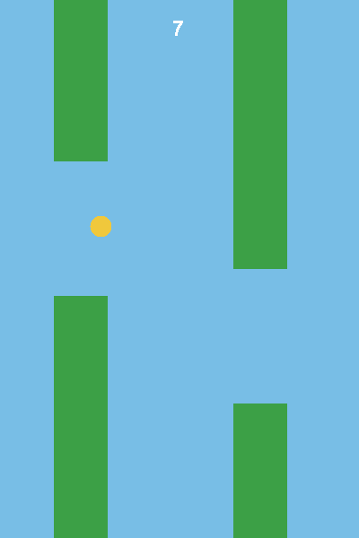
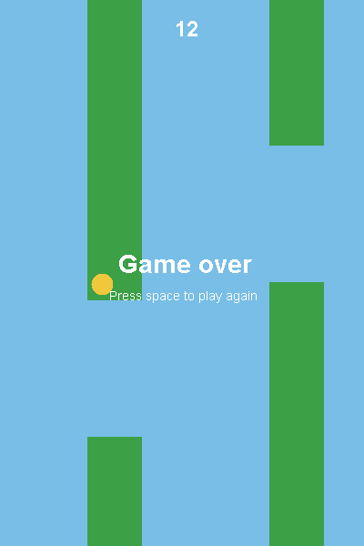

🇬🇧 English | 🇩🇪 [Deutsch](../de/01-flappy-bird.md)

[← Back to the course list](../../../README.md) · Requires: [Course 1 – Basics](../../01-basics/en/00-introduction.md)

# Course 7 – Flappy Bird

**Goal:** one key, gravity, and a gap to aim at. The last course in this
repository, and the first where movement is not a step on a grid but a speed
that changes in every frame.



Requires [Course 1](../../01-basics/en/00-introduction.md) and nothing else. If
you have done Course 6, the next two sections will look familiar and you can skip
them. A finished version is in [`code/`](../code/), in three files.

## 🟢 Core — Classes and objects, in short

*(If you have done Course 6, skip this and carry on at the next section.)*

Course 1 called a class "a box with a name". The full answer is that a class
describes in one place what something **is** and what it **can do**: the values it
holds, called **fields**, and the methods that work on them. `new` builds a real
one out of it, an **object**, and every object has its own fields.

This game needs that twice, for two different reasons.

The panel needs it because the bird's height, speed and score have to survive
between two frames, and a `static` method from Course 1 has nowhere to keep
anything.

The pipes need it because there are three of them and they are all the same kind
of thing with different numbers inside. Without a class you would be juggling
`pipeX1`, `pipeX2`, `pipeX3`, `pipeGapY1` and so on, and every piece of code that
touches a pipe would have to say three times which one it means.

Four words appear below that Course 1 never showed.

`extends` means "start from this class and change one thing". `FlappyPanel`
therefore has everything a `JPanel` can do from its first line, and you only write
what should be different about it.

`@Override` is a promise to the compiler: "this method already exists above me, I
am replacing it". It is optional but useful. Misspell the name — `paintcomponent`
with a small c — and without `@Override` that is a new method nobody calls, and
your window stays empty. With `@Override` it is an error that tells you what is
wrong.

`private` on a field means only this class may touch it. And `final` on a class
means nobody may build a variation on top of it; why it is here is explained in the
next section, at the point where it shows.

## 🟢 Core — The four Swing facts this game needs

*(If you have done Course 6, skip this and carry on at the next section.)*

Swing is Java's toolbox for windows, and it sits on top of the older AWT. Three
classes here come from Swing itself: `JFrame`, `JPanel` and `Timer`. Everything
that draws or reads keys comes from AWT. That is why `java.awt` imports sit next to
`javax.swing` imports below, and it is not a mistake.

**Something to draw on.** A `JFrame` is the window, and you do not draw on it. You
put a `JPanel` inside it, and you build your own with `extends JPanel` and one
overridden method:

```java
import java.awt.Color;
import java.awt.Graphics;
import javax.swing.JPanel;

public final class FlappyPanel extends JPanel {

    static final int WIDTH = 400;
    static final int HEIGHT = 600;

    @Override
    protected void paintComponent(Graphics g) {
        super.paintComponent(g);
        g.setColor(Color.GREEN);
        g.fillRect(60, 0, 60, 180);
    }
}
```

That is a complete file. Type it out, save it as `FlappyPanel.java` and run
`javac FlappyPanel.java` over it: it compiles. You cannot run it yet, there is no
`main` and no window.

`super.paintComponent(g)` lets the original clear the background first.
`Graphics g` does the drawing: `fillRect` for the pipes, `fillOval` for the bird,
`drawString` for the score. The coordinates are pixels from the top left, and
**y grows downwards**, which matters more here than in any other course, because
that is the direction gravity pulls in.

`protected` in front of `paintComponent` means "for me and for anyone who inherits
from me, but not for the public". That is not your decision, it is `JPanel`'s: when
overriding you may make a method more accessible but never less, and `protected` is
the comfortable answer.

The class is `final`, out of caution rather than necessity. Its constructor calls
`setBackground` further down, a method inherited from `JPanel`. A subclass could
override `setBackground`, and its version would then run before its own fields
exist. The compiler sees that danger, but it only warns when the danger is real,
and that takes two things: a class without `final` **and** a constructor somebody
outside can reach. Try both:

```
remove the final                               -> silence, no warning
remove it and write public before FlappyPanel() ->
warning: [this-escape] possible 'this' escape before subclass is fully initialized
```

The constructor here has no visibility keyword, so it can only be reached from
inside its own package, which is why it would stay silent without `final` too. The
`final` is there anyway because it rules the danger out for good — including on the
day somebody writes `public` in front of the constructor to create the panel from
elsewhere. This repository compiles with warnings as errors, and a warning that
only appears through a later, harmless-looking change costs more time than the one
word.

**Something that redraws.** You never call `paintComponent`. You call `repaint()`,
and Swing calls `paintComponent` when it gets round to it. So the rule is: change
the numbers first, then ask for a new picture.

**Something that drives.** A game where something falls needs a steady heartbeat.
That is a `javax.swing.Timer`, which calls you back at a fixed interval:

```java
import java.awt.event.ActionListener;
import javax.swing.Timer;

ActionListener step = event -> {
    panel.tick();
    panel.repaint();
};
new Timer(16, step).start();
```

The arrow notation is a method without a name. `event -> { ... }` means "take one
parameter, call it `event`, and run this". It is allowed because `ActionListener`
demands exactly one method; there is nothing to confuse, so Java lets the name go.
Written out it would be a class of its own implementing `ActionListener`, and ten
lines for the same thing.

The 16 milliseconds are a request, not a promise. On paper they would be 62 frames
per second; measured on Windows you get about 32, because the system clock there
only advances every 15.6 milliseconds and 16 is therefore rounded up to a little
over 31. The game plays fine at that, but it shifts the numbers: `GRAVITY` and
`FLAP` have to feel right at the rate your machine actually delivers. Measure it
once if the controls feel sluggish. A counter that goes up on every tick and a
print every second are enough.

A `while` loop with `Thread.sleep` would not do: Swing redraws on the same thread,
so a sleeping game is a frozen window.

Import `javax.swing.Timer` by name. There is also a `java.util.Timer`, and
importing both with a star makes the name ambiguous.

**Something that reads keys.** A window gets the key at the moment it is pressed,
and that is exactly what the console cannot do. Three things belong together here:

```java
import java.awt.event.KeyAdapter;
import java.awt.event.KeyEvent;

panel.setFocusable(true);

panel.addKeyListener(new KeyAdapter() {
    @Override
    public void keyPressed(KeyEvent event) {
        if (event.getKeyCode() == KeyEvent.VK_SPACE) {
            panel.flap();
        }
    }
});
```

`setFocusable(true)` allows the panel to receive keys. On a `JPanel` that is
allowed to begin with, so the line changes nothing here; it is there because other
components are not like that, and then you spend a long time looking.
`addKeyListener` attaches the listener, and without it nothing arrives at all.

`KeyAdapter` is a class with three empty methods, of which you override the one you
care about. `new KeyAdapter() { ... }` creates a variation of it on the spot,
without giving it a name — the same shortcut as the `event ->` above, only for a
class with several methods. The body in braces after the `new` is what
`extends KeyAdapter` would be if you gave it a file of its own.

`keyPressed` and not `keyTyped`. `keyTyped` only exists for keys that produce a
character, and it gives you no `getKeyCode`. The space bar does produce one, arrow
keys do not, and `keyPressed` works for both. The key names are constants in
`KeyEvent`: `VK_SPACE`, `VK_LEFT`, `VK_UP`.

## 🟢 Core — The numbers that make the game

Eleven constants sit at the top of the class, and nearly every piece of code in
this chapter uses one of them. Write them down before you go on, otherwise your
compiler will start failing to find names from the next section onwards:

```java
static final int WIDTH = 400;
static final int HEIGHT = 600;

static final int GAP = 150;        // the hole between upper and lower pipe
static final int MARGIN = 60;      // keeps the gap away from the edges
static final int PIPE_WIDTH = 60;
static final int PIPE_SPACING = 200;
static final int PIPE_SPEED = 3;

static final int BIRD_X = 100;
static final int BIRD_SIZE = 24;
static final double GRAVITY = 0.5;
static final double FLAP = -8.0;
```

They sit inside the class and outside every method, and that is what lets every
method of the class reach them. It is the difference from the `final int` in
Course 1, which sat inside a method and only counted there. `static` means
"belongs to the class, not to a single object", `final` means "never changes".

**No `private` in front of them.** That is not a matter of taste: `Pipe` from the
section below reads `MARGIN`, `HEIGHT` and `GAP`, and with `private` you get
`MARGIN has private access in FlappyPanel`. Fields only the panel really needs —
`birdY`, `score`, `gameOver` — may and should be `private`.

**And do not leave out either of the first two.** Forget `HEIGHT` and the compiler
says nothing. `JPanel` inherits a `HEIGHT` of its own through an interface called
`ImageObserver`, and that one is `2`; `WIDTH` there is `1`. Your playing field
would be two pixels high, the sum for the gap would come to -74, and a rectangle
with a negative height is simply not drawn by `fillRect`. The window would stay
empty, without a single warning. You only find this kind of bug if you know it
exists.

## 🟢 Core — Movement as a speed, not as a step

Every game so far has moved things by whole squares. Here the bird has a **speed**,
and two lines carry all of the physics:

```java
velocity = velocity + GRAVITY;
birdY = birdY + velocity;
```

Gravity does not move the bird. It changes how fast the bird moves, and the speed
moves it. Falling therefore starts slowly and gets faster on its own, which is
exactly what falling does.

A flap is an assignment:

```java
velocity = FLAP;      // a negative number: upwards
```

Not "go up", but "from now on you are moving upwards at this speed". Gravity starts
eating into it immediately, so the bird rises, slows, stops and falls again,
without a single line describing that arc. Two of the constants above produce it:
`GRAVITY` and `FLAP`.

Both fields are `double`, and that is not fussiness:

```java
private double birdY = HEIGHT / 2.0;
private double velocity;
```

Try it with `int birdY` and you get two different answers depending on how you
write the line. The one above does not compile at all any more:

```
error: incompatible types: possible lossy conversion from double to int
        birdY = birdY + velocity;
```

The short form `birdY += velocity` does compile, because `+=` quietly converts back
to `int`. It throws the fraction away in every frame, the movement stutters, and
all the compiler says about it is:

```
warning: [lossy-conversions] implicit cast from double to int in compound
assignment is possibly lossy
```

This repository compiles with `-Werror`, so this warning becomes an error here as
well. On your machine without that flag it is one line of text that slips past, and
then you look for the stutter in the wrong place. Leave both `double` and convert
once, right at the end, where drawing needs whole pixels:

```java
g.fillOval(BIRD_X, (int) birdY, BIRD_SIZE, BIRD_SIZE);
```

The bird never moves sideways. The pipes come to it, and that is less work and
looks the same.

## 🟢 Core — A class that is only data

Three pipes exist for the whole game. When one leaves the screen on the left it
travels back to the right with a new gap, rather than being thrown away and
replaced. So the program creates three objects and no more.

This goes into a file of its own, `Pipe.java`, and it is complete:

```java
public final class Pipe {

    int x;
    int gapY;
    boolean passed;

    Pipe(int x) {
        recycle(x);
    }

    void recycle(int x) {
        this.x = x;
        this.gapY = FlappyPanel.MARGIN + (int) (Math.random()
                * (FlappyPanel.HEIGHT - FlappyPanel.GAP - 2 * FlappyPanel.MARGIN));
        this.passed = false;
    }
}
```

It needs no import at all: `Math` lives in `java.lang` and is always there.

`x` is the left edge, `gapY` the top edge of the hole, and `passed` remembers
whether this pipe has been counted, so that one pipe cannot score twice.

There is only one place that places a pipe, so the constructor uses the same method
as the later recycling. A constructor calling a method of its own is harmless here
because the class is `final`: nobody can swap `recycle` out underneath it. That is
exactly the danger from the Swing section, seen from the useful side.

The constants live in `FlappyPanel`, so `Pipe` has to say which class they belong
to. Inside `FlappyPanel` you write `MARGIN`, from outside `FlappyPanel.MARGIN`. It
is the same rule that makes you write `Math.random()` and not `random()`.

`this.x = x` looks odd the first time. Parameter and field have the same name, so
`this.` says "the field, not the parameter". You could name them differently and do
without it; the convention exists because the two really are the same thing wearing
two hats.

The fields and `recycle` have no visibility keyword. That is not sloppiness:
`FlappyPanel` reads `pipe.x` and calls `pipe.recycle(...)`, and with `private`
neither would work. Anything another class in the same package uses leaves the word
off; everything else becomes `private`.

Why a file of its own: a second class sharing `FlappyPanel.java` would be hidden in
there, and the compiler warns about a class that is used from elsewhere and does
not sit in a file of its own name.

Keep the three in an array, back in `FlappyPanel`:

```java
private final Pipe[] pipes = new Pipe[3];
```

`new Pipe[3]` makes room for three pipes and no pipe. Every slot holds `null` to
begin with, meaning "there is no object here", and every access to one ends in a
`NullPointerException`. That is the one difference from the `int[]` arrays in
Course 1, where the slots arrived holding zeroes.

The array is filled in the constructor, and only there:

```java
FlappyPanel() {
    setBackground(new Color(120, 190, 230));

    for (int i = 0; i < pipes.length; i++) {
        pipes[i] = new Pipe(WIDTH + i * PIPE_SPACING);
    }

    reset();
}
```

That puts the three in a row off-screen to the right, `PIPE_SPACING` pixels apart,
from where they come in one at a time. `reset` appears further down and deliberately
creates no pipes any more; it pushes the existing ones back.

## 🟢 Core exercise — One step of the game

From here on you write. Everything that follows goes into the same file,
`FlappyPanel.java`: first the eleven constants, then the fields, then the
constructor, then `reset`, `tick`, `collides`, `flap` and `paintComponent`. The
order is taste; what matters is that they all sit inside the same braces.

```java
void tick() {
    // your code here -- the six steps below
}
```

1. If the game is over or has not started, return and do nothing.
2. **Gravity.** Add `GRAVITY` to the speed, then the speed to `birdY`. In that
   order: the new speed applies to this frame.
3. **Pipes.** Subtract `PIPE_SPEED` from every pipe's `x`.
4. **Recycling.** If a pipe's right edge is past 0 on the left, push it back to the
   right and give it a new gap. Put it `pipes.length * PIPE_SPACING` further right
   than where it currently is, so that it lands behind the other two and not on top
   of one.
5. **Score.** If a pipe has not been counted and its right edge is now left of the
   bird, mark it as counted and add a point.
6. **Dying.** Call `collides()` from the next section, and if the answer is yes, set
   `gameOver` to true.

Steps 3 to 5 belong in the same loop over the pipes. Step 6 comes after it and runs
once per frame, not once per pipe.

Do not leave step 6 until last. Without it the bird flies straight through the
pipes, and you will think the method from the next section is broken when in fact
nobody is calling it.

Steps 4 and 5 both ask "where is the right edge", and that is `pipe.x + PIPE_WIDTH`
and not `pipe.x`. Get that wrong and you get both too early: the point one pipe
width before the bird is past, and the recycling while the right half of the pipe
is still on screen. You can see the second one; it is a twitch at the left edge.

Step 5 is the reason `passed` exists. Without it every frame in which the bird is
past the pipe counts another point, and the score runs away at thirty a second.

## 🟢 Core exercise — Did it hit anything

```java
private boolean collides() {
    // your code here -- the two parts below
}
```

**Off the screen.** If `birdY` is below 0 or `birdY + BIRD_SIZE` is beyond
`HEIGHT`, the bird is out.

**Into a pipe.** Every pipe is two rectangles with a hole between them: an upper one
from the very top down to `gapY`, and a lower one from `gapY + GAP` to the very
bottom. The bird is a third rectangle. The question is whether the bird's rectangle
overlaps either of the two.

Java answers that for you, with `import java.awt.Rectangle;`:

```java
Rectangle bird = new Rectangle(BIRD_X, (int) birdY, BIRD_SIZE, BIRD_SIZE);
Rectangle upper = new Rectangle(pipe.x, 0, PIPE_WIDTH, pipe.gapY);

if (bird.intersects(upper)) {
```

A `Rectangle` is four numbers: left, top, width, height. `intersects` answers
whether two of them overlap anywhere.

It is worth knowing what happens in there instead of treating it as magic. Two
rectangles overlap if they overlap horizontally **and** vertically, and they overlap
horizontally if each one's left edge is left of the other's right edge. That is four
comparisons joined with `&&`, and you could write them yourself. Taking the library
version here means one less thing you can get subtly wrong while you are also
learning about gravity.

You build the lower rectangle yourself. Its top edge is `gapY + GAP`, and its height
is whatever is left of the screen below that.

## 🟢 Core — What you see

The code here is complete, unlike in the two sections before it. There is nothing to
work out about drawing, it is legwork with numbers, and without it you cannot see
whether your gravity is right. The picture at the top of this chapter is exactly
what this method paints:

```java
@Override
protected void paintComponent(Graphics g) {
    super.paintComponent(g);

    g.setColor(new Color(60, 160, 70));
    for (Pipe pipe : pipes) {
        g.fillRect(pipe.x, 0, PIPE_WIDTH, pipe.gapY);
        g.fillRect(pipe.x, pipe.gapY + GAP, PIPE_WIDTH,
                HEIGHT - pipe.gapY - GAP);
    }

    g.setColor(new Color(240, 200, 60));
    g.fillOval(BIRD_X, (int) birdY, BIRD_SIZE, BIRD_SIZE);

    g.setColor(Color.WHITE);
    g.setFont(new Font("SansSerif", Font.BOLD, 24));
    g.drawString(String.valueOf(score), WIDTH / 2 - 8, 40);

    g.setFont(new Font("SansSerif", Font.PLAIN, 14));
    if (!started && !gameOver) {
        g.drawString("Press space to start", WIDTH / 2 - 65, HEIGHT / 2 + 60);
    }

    if (gameOver) {
        g.setFont(new Font("SansSerif", Font.BOLD, 28));
        g.drawString("Game over", WIDTH / 2 - 70, HEIGHT / 2);
        g.setFont(new Font("SansSerif", Font.PLAIN, 14));
        g.drawString("Press space to play again", WIDTH / 2 - 80, HEIGHT / 2 + 30);
    }
}
```

Add `import java.awt.Font;` for this, and you already have `java.awt.Color`.

`new Color(60, 160, 70)` is red, green and blue from 0 to 255. The named constants
like `Color.GREEN` exist too, they are just garish; three numbers are the whole tool
for changing that.

The background is not drawn here. `setBackground` in the constructor tells Swing the
colour, and `super.paintComponent(g)` in the first line fills the area with it.
Leave that first line out once and you will see what it does: the bird smears,
because nothing clears the old picture any more, and the sky is gone.

The order decides what sits on top. Pipes, then bird, then text — the other way
round and the bird would disappear behind a pipe.

`drawString` sets the baseline of the text, not its top edge. That is why the score
uses `40` and not `0`; at `0` it would be above the edge of the screen.

Numbers like `WIDTH / 2 - 65` are rough centring. Really centring a line goes
through `g.getFontMetrics().stringWidth(text)`, and that is a worthwhile small
exercise once the rest runs.

## 🟢 Core — Starting, dying, starting again

The bird should not fall before the player is ready, and a finished game should be
playable again without restarting the program. The fields that are still missing for
that and for the drawing sit with the others at the top of the class:

```java
private double birdY = HEIGHT / 2.0;
private double velocity;
private final Pipe[] pipes = new Pipe[3];
private int score;
private boolean started;
private boolean gameOver;
```

`tick` does nothing as long as `started` is not true and `gameOver` is not false.
The space bar does three different things depending on which state you are in:

```java
void flap() {
    if (gameOver) {
        reset();
        return;
    }
    started = true;
    velocity = FLAP;
}
```

The first press starts the game and flaps. Later presses flap. A press after death
starts over:

```java
void reset() {
    birdY = HEIGHT / 2.0;
    velocity = 0;
    score = 0;
    gameOver = false;
    started = false;
    for (int i = 0; i < pipes.length; i++) {
        pipes[i].recycle(WIDTH + i * PIPE_SPACING);
    }
}
```

Note what is **not** here: no `new Pipe`. The three objects are created in the
constructor, `reset` only pushes them back. So the constructor must contain the loop
with `new`, and it must come **before** the call to `reset()`. Otherwise `recycle`
reaches into `null`, and you start into a `NullPointerException` before the window
appears.

`flap` and `reset` again have no visibility keyword, because `FlappyBird` calls
them. `collides` is `private`, because it does not.

The wiring goes into the third file, `FlappyBird.java`, and it is short enough to
show in full:

```java
import java.awt.Dimension;
import java.awt.event.ActionListener;
import java.awt.event.KeyAdapter;
import java.awt.event.KeyEvent;
import javax.swing.JFrame;
import javax.swing.SwingUtilities;
import javax.swing.Timer;

public class FlappyBird {

    public static void main(String[] args) {
        SwingUtilities.invokeLater(FlappyBird::start);
    }

    static void start() {
        FlappyPanel panel = new FlappyPanel();
        panel.setPreferredSize(new Dimension(FlappyPanel.WIDTH, FlappyPanel.HEIGHT));
        panel.setFocusable(true);

        panel.addKeyListener(new KeyAdapter() {
            @Override
            public void keyPressed(KeyEvent event) {
                if (event.getKeyCode() == KeyEvent.VK_SPACE) {
                    panel.flap();
                }
            }
        });

        JFrame frame = new JFrame("Flappy Bird");
        frame.setDefaultCloseOperation(JFrame.EXIT_ON_CLOSE);
        frame.add(panel);
        frame.pack();
        frame.setLocationRelativeTo(null);
        frame.setResizable(false);
        frame.setVisible(true);

        panel.requestFocusInWindow();

        ActionListener step = event -> {
            panel.tick();
            panel.repaint();
        };
        new Timer(16, step).start();
    }
}
```

Four places in there deserve a sentence.

`FlappyPanel.WIDTH` is qualified here, with the class name in front. Inside
`FlappyPanel` a plain `WIDTH` is enough; here it is not. `FlappyBird` is a different
class, and without the prefix you get `cannot find symbol`.

`SwingUtilities.invokeLater` builds the window on Swing's own thread rather than on
the one `main` runs on. Swing requires that, and `FlappyBird::start` is the short
form for "call this method", like the `event ->` further up but without a parameter.

`setPreferredSize` plus `pack()` instead of `setSize`: the panel says how big it
wants to be and the window lays itself around it. With `setSize` on the window, the
panel would get that space minus the title bar and border — measured, 14
pixels narrower and 37 pixels shorter than asked for. Your death line at the bottom
would then not be where you think it is, and the rightmost column of pipe would
stick out of the picture.

`requestFocusInWindow()` comes **after** `setVisible(true)`. Before that there is no
window to hand out the focus. On a freshly opened window it usually works before it
too, because the system activates it anyway; this order is the one you can rely on,
and it costs nothing.

```
javac *.java
java FlappyBird
```

Three files this time, so `javac *.java` again, and again not
`java FlappyBird.java` — single-file launching compiles only that one file and then
does not find `FlappyPanel`.



If you want to compile with this repository's real flags, use
`javac --release 21 -Xlint:all,-serial -Werror *.java`. The `-serial` has to be
there: every subclass of `JPanel` is serializable by default and has no
`serialVersionUID`, and without that exception you fail on it rather than on your
own code.

## 🟡 Optional — Pipes that come and go

Three recycled pipes are the version that needs nothing beyond Course 1. The
grown-up version creates a pipe when one is due and removes it when it leaves the
screen, and for that you want a list instead of an array, because the number changes
while the program runs:

```java
import java.util.ArrayList;
import java.util.List;

private final List<Pipe> pipes = new ArrayList<>();
```

`add` appends one, `remove` takes one out, `size()` is the count, and the enhanced
`for` from Course 1 runs over it unchanged. The angle brackets say what is inside, so
the compiler knows a `Pipe` comes out.

One trap, and it is the reason this is optional rather than the main path: removing
from a list while a `for` loop runs over it usually throws
`ConcurrentModificationException`. Usually, not always. Catch the second-to-last
element and the loop ends by itself afterwards and notices nothing — the next check
compares position against length and happens to find them equal. A bug that shows up
on three out of four elements and keeps quiet on the fourth is worse than one that
always bangs. Collect what should go and remove it afterwards, or walk the indices
backwards.

## 🟡 Optional — Make it fair

Three numbers decide whether this game is pleasant or maddening: `GRAVITY`, `FLAP`
and `GAP`.

Change one at a time and play five rounds after each change. Then write in a comment
why your numbers are the ones you settled on. The useful question is not "is it
hard" but "when I die, do I believe it was my fault".

Worth doing on paper: with `GRAVITY` 0.5 and `FLAP` -8, how many frames pass before
a flap is completely used up? The answer tells you the rhythm the game makes the
player tap in. Then convert it into seconds, using the frame rate you measured and
not the 62 from theory. At around 32 frames per second the same arc lasts twice as
long, and that is why the same numbers play differently on two machines.

## 🔴 Optional, genuine challenge — A score that outlives the program

Keep the best score in a file next to the program, read it at startup, and write it
when a round beats it.

```java
import java.io.IOException;
import java.nio.file.Files;
import java.nio.file.Path;
```

`Files.writeString(Path.of("highscore.txt"), String.valueOf(score))` writes, and
`Files.readString(Path.of("highscore.txt"))` reads back. Both can go wrong, and
unlike `Thread.sleep` in Course 4 you have to handle it here rather than pass it on,
because a missing file is normal on the first run and must not stop the game:

```java
static int readBest() {
    try {
        String text = Files.readString(Path.of("highscore.txt"));
        return Integer.parseInt(text.trim());
    } catch (IOException | NumberFormatException e) {
        return 0;
    }
}
```

`try` runs the risky part, `catch` says what to do on failure. Here "no file yet" and
"the file is unreadable" honestly both mean "no best score yet", so both return 0.

The vertical bar in the `catch` catches two different failures with the same block.
Both are needed, and they come from different lines: `readString` throws
`IOException` when the file is missing, and `Integer.parseInt` throws
`NumberFormatException` when what is in it is not a number. With only
`catch (IOException e)` the method does compile, but it crashes on the second test
below, in a place where you would not suspect the cause.

Writing needs the same treatment:

```java
static void writeBest(int best) {
    try {
        Files.writeString(Path.of("highscore.txt"), String.valueOf(best));
    } catch (IOException e) {
        // No high score is no reason to stop the game.
    }
}
```

An empty `catch` block is usually a bad sign. Here it is right, and the comment says
why. Without it, the next person to see this reads "something was forgotten here".

Three things to test, and the second is the one everybody forgets. Delete the file
and start the game. Write the word `banana` into it and start the game. And beat
your own record twice in one session, so that the writing happens more than once.

## 🔴 Optional, genuine challenge — Ground that moves

The sky is empty, so nothing shows how fast the bird is travelling. Draw a strip of
ground at the bottom and let it scroll left at `PIPE_SPEED`.

The trick is making it endless without endless marks. Draw them at a fixed spacing,
keep an offset that counts down from the spacing to 0 and then jumps back, and draw
from `-spacing` onwards so that a mark coming in from the right is already on screen
when it is needed.

The ground is decoration, so do not let the bird collide with it; it dies at `HEIGHT`
anyway. But if you make it tall enough to see, pull the death line in `collides` up
to its top edge, otherwise the bird visibly sinks into it before the game notices.

And then you have a second problem that comes straight out of the first: `recycle`
works out `gapY` from `HEIGHT`, so the lower pipe can now stick into the ground, or a
gap can sit so low that the bird cannot reach it without dying. Introduce a number
for the playable height, use it in all three places — drawing the gap, drawing the
lower pipe, the death line — and keep `HEIGHT` for the window only. That is the real
work in this exercise, not the strip.

## What you learned

- Movement as a speed that gravity changes, instead of a fixed step
- Why `birdY` and `velocity` are `double`, and the compiler's two different answers
  to `=` and `+=` when they are not
- Converting to `int` once, at the point of drawing
- A class whose job is holding data, and `this.x = x` when the names match
- An array of objects, where `new Pipe[3]` makes room but no pipes
- Recycling objects instead of creating and discarding them
- `Rectangle` and `intersects`, and which four comparisons they stand for
- A marker like `passed`, so that something happens once instead of every frame
- Two booleans for "not started" and "over", and one key with three meanings
- A `reset` method called from the constructor and from the restart, and why only
  the constructor says `new` even so
- `extends`, `@Override`, `protected`, and what it means when a method has no
  visibility keyword at all
- A method without a name after `->` and a class without a name after `new`
- Keys through `addKeyListener` and `keyPressed`, and why the focus is requested
  after `setVisible`
- That `Timer(16)` is a request, and delivers about 32 frames per second on Windows
- That an inherited constant like `ImageObserver.HEIGHT` silently stands in for one
  you forgot to declare
- *(optional)* `ArrayList`, and why removing during a loop usually throws
- *(optional)* `try` and `catch`, one `catch` for two kinds of failure, and a
  missing file as the normal case

## Next

That was the last course in this repository. Seven games, from a board made of
dashes to a bird falling at thirty frames a second, and nothing installed but the
JDK.

What comes after is in [PROJECT-IDEAS.md](../../../PROJECT-IDEAS.md): Pong,
Minesweeper, Breakout and Tetris are all within reach of what you can do now, and
the last entry is the one that leaves the bare JDK behind for a build tool and real
tests. None of them is written. The list is there because the next game you build
yourself teaches more than another chapter to read.
